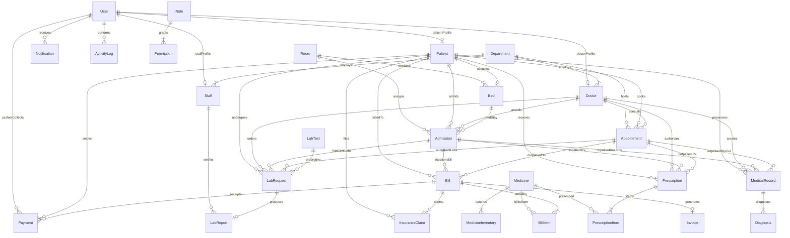

# Production Hospital Management System (HMS / ERP) - Entity-Relationship Diagram

This document presents the relational architecture of the **CarePulse Hospital Management System**.
The architecture improves upon the reference ER diagram by normalizing clinical, financial, and pharmaceutical entities into an enterprise-ready model.

---

## 1. Relational Architecture Diagram (Mermaid)

---

## 2. Key Architectural Enhancements Over Reference Diagram

| Baseline ER Diagram Feature | Production HMS ERP Enhancement | Why It Matters in Real Hospitals |
| :--- | :--- | :--- |
| Single flat `Staff` table with designations | Typed `User` with `Doctor` and `Staff` sub-entities + RBAC `Role`/`Permission` | Enables fine-grained security, license validation, and specific consultation fees. |
| Basic `Room` without bed tracking | Hierarchical `Room` (1) ➔ `Bed` (N) model with status flags (`OCCUPIED`, `CLEANING`, `MAINTENANCE`) | Real hospitals allocate specific beds inside multi-bed general wards and ICUs. |
| Inpatient / Outpatient split without common patient identity | Unified `Patient` (UHID) linked polymorphically to `Admission` and `Appointment` | Patients maintain a single lifetime clinical health record (EHR) across both OPD and IPD visits. |
| Generic Medicine string in bill | `Medicine` formulary catalog with `MedicineInventory` batch tracking & expiry dates | Enables FIFO batch deduction, prevents dispensing expired lots, and tracks unit costs. |
| Direct total price entry | Itemized `Bill` and `BillItem` with real-time balance calculations, multiple payment receipts (`Payment`), and printable `Invoice` | Supports partial payments, insurance TPA co-pays, itemized pharmacy bills, and accounting compliance. |
| Lack of Diagnostic Lab workflow | Dedicated `LabTest`, `LabRequest`, and pathologist-verified `LabReport` pipeline | Critical diagnostic loop connecting doctor orders to technician analysis and abnormal flag alerts. |
| No compliance audit trail | Automated `ActivityLog` and `Notification` engines | Full HIPAA/HL7-style auditable access logs for patient privacy and regulatory compliance. |
